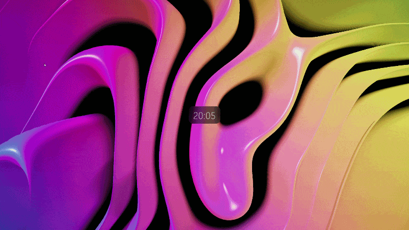

# Liquid Glass
A wallpaper engine project which includes a moving abstract background and media player information

Liquid Glass is a Wallpaper Engine web wallpaper featuring animated, glass-like ribbons, a digital clock, and a now-playing card.

## Features

- Animated WebGL background with adjustable motion, ribbon shape, lighting, and color.
- 24-hour digital clock.
- Now-playing card with album art, track information, and playback progress.
- Live settings that can be adjusted in Wallpaper Engine.

### Run the project

Open `index.html` in a browser that supports WebGL and can load the local shader files.

To use the media player, the project must be opened in wallpaper engine.

## Live Demo

[Live preview without media player](https://luca-r04.github.io/Liquid-Glass-Wallpaper/)
